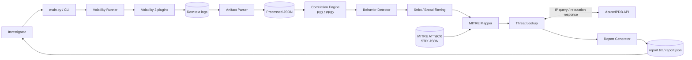
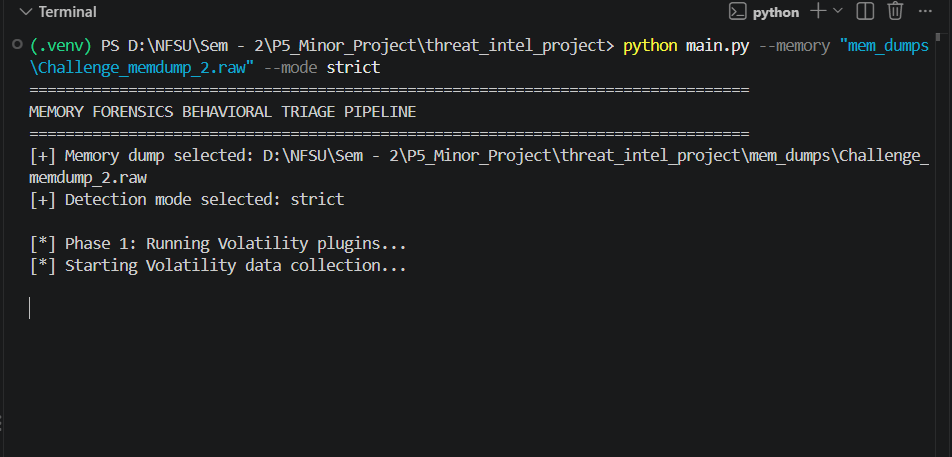

# Behavioral Triage in Memory Forensics

**Behavioral Triage in Memory Forensics Using MITRE ATT&CK and Threat Intelligence**

A Windows memory-forensics triage pipeline that uses Volatility 3 to extract runtime artifacts, correlates process and network evidence, identifies suspicious behavior, maps findings to MITRE ATT&CK, enriches public IP indicators with AbuseIPDB, and generates prioritized TXT and JSON reports.

> **Purpose:** help an investigator prioritize evidence for review. This tool is a triage aid; it does not independently prove that a process or system is malicious.

## Problem

Volatility produces separate process, process-tree, command-line, and network outputs. Manually reviewing and correlating these artifacts can be time-consuming. Process names and isolated strings are also weak indicators and may create false positives.

## What the tool does

1. Accepts a Windows memory image through the command line.
2. Runs selected Volatility 3 plugins and saves raw output.
3. Parses raw logs into structured JSON.
4. Correlates process, parent, path, command-line, and network evidence using PID/PPID.
5. Applies seven behavioral rules, with broad and strict detection modes.
6. Maps behavior labels to MITRE ATT&CK technique IDs and retrieves technique metadata from a local STIX dataset.
7. Checks public remote IPs through the AbuseIPDB API.
8. Generates a prioritized `report.txt` and structured `report.json`.

## Architecture



## Evidence sources

| Volatility 3 plugin | Evidence | Use in this project |
|---|---|---|
| `windows.psscan` | Process objects, PID/PPID and available process times | Builds the process inventory. The current runner saves this output as `pslist.txt`. |
| `windows.pstree` | Parent-child process relationships and process context | Supports process-lineage and path analysis. |
| `windows.cmdline` | Process command-line arguments | Supports command-line and execution-context analysis. |
| `windows.netscan` | Network endpoints and owning PID, when available | Associates connections with processes and identifies public IPs for enrichment. |

## Seven behavioral parameters

| Behavior label | What the rule checks | Interpretation |
|---|---|---|
| `execution_from_user_writable_directory` | Paths under locations such as `Users`, `Downloads`, `Desktop`, `Temp`, `AppData`, or `Public` | A medium contextual signal; legitimate applications can also run from these paths. |
| `external_network_communication` | A process is associated with a public remote IP in `netscan` | Not inherently malicious; correlate the owning process, path, parent, and IP reputation. |
| `suspicious_commandline_execution` | Configured markers associated with encoded commands, scripting, downloads, or bypass behavior | Review the complete command line; a marker match alone is not a verdict. |
| `lolbin_or_script_host_execution` | Selected Windows utilities and script hosts commonly abused by attackers | Weak by itself because these are legitimate Windows tools. |
| `unusual_process_name` | Heuristics for random-looking or generic executable names | Weak by itself; use path and execution context for corroboration. |
| `suspicious_parent_child_execution` | Selected parent-child combinations and execution context | Process lineage can reveal suspicious execution chains that a process name alone would miss. |
| `system_process_path_mismatch` | Whether selected Windows system process names appear in expected paths | May indicate masquerading; verify the recovered path and Windows context. |

### Why correlation matters

The detector evaluates each process using its name, PID, PPID, parent name, path, command line, and associated network connections. Examples:

- **Unknown executable in Downloads + unusual name:** more concerning than either indicator alone, but still not proof of malware.
- **`winword.exe` → `powershell.exe` + encoded or download-related arguments:** stronger execution-chain evidence than seeing PowerShell alone.
- **Unknown process + public remote IP:** investigate the owning PID, executable path, parent, command line, and IP reputation. A public IP alone does not prove command-and-control activity.
- **Known enterprise process + expected vendor path:** weak-only alerts may be suppressed in strict mode, with the suppressed record retained for review.

## Broad mode vs. strict mode

- **Broad (`--mode broad`):** retains every process with at least one detected behavior. Use it for exploration and rule-coverage testing.
- **Strict (`--mode strict`):** applies false-positive filtering. Weak-only or trusted-context findings may be written to `suppressed_findings.json` rather than silently discarded. Strict is the default.

Broad mode increases visibility, not accuracy. Strict mode reduces noise, but suppressed findings should still be available for analyst review.

## MITRE ATT&CK mapping

The mapping has two distinct steps:

1. The project maps its internal behavior labels to selected ATT&CK technique IDs using a local rule mapping (for example, a behavior may map to `T1204.002`).
2. `mitre_mapper.py` searches `data/mitre/enterprise-attack.json` and retrieves technique metadata such as the technique name, tactic, and reference URL.

MITRE ATT&CK is a knowledge base, not a memory-dump detection engine. A mapping is a standardized description of a possible behavior, not confirmation that an adversary technique occurred.

## Threat intelligence: AbuseIPDB

The threat-lookup stage submits public remote IP indicators associated with findings to the AbuseIPDB API and adds available reputation details, such as abuse-confidence score, report count, country, usage type, ISP, and domain. The memory dump itself is not uploaded by this lookup stage.

An AbuseIPDB score is contextual intelligence, not proof that a process or IP is malicious or benign. The API's `maxAgeInDays` parameter is documented for values from **1 to 365 days**; it does not provide a five-year report window.

## Prioritized output

The report groups retained findings into:

- **HIGH INTEREST** — stronger rule combinations or enrichment context; review first.
- **SUSPICIOUS** — meaningful but less conclusive behavioral evidence.
- **REVIEW** — weak, incomplete, or context-dependent evidence that still deserves consideration.

These are heuristic triage categories, not malware verdicts or calibrated probabilities. `report.txt` is for human review; `report.json` preserves structured findings.

### Example run

One captured demonstration run produced the following results. These are sample-run counts, **not** benchmark or accuracy claims.

| Measure | Observed result |
|---|---:|
| Correlated processes analysed | 218 |
| Findings retained in strict mode | 18 |
| Weak findings saved separately | 22 |
| HIGH INTEREST / SUSPICIOUS / REVIEW | 1 / 16 / 1 |
| Unique external IPs checked | 1 |

The sample report included an AbuseIPDB result with an abuse score of `0`, illustrating why external communication must be assessed using process context and more than one source of evidence.

**Interpretation caution:** the captured HIGH INTEREST example includes `SearchApp.exe` under a Windows SystemApps path and an external endpoint whose AbuseIPDB score was `0`. This is a triage result, not a confirmed malware detection. It should be manually validated and used as a candidate for improving the process baseline and false-positive rules.

## Repository structure

```text
.
├── main.py
├── requirements.txt
├── .env                         # local only; never commit
├── mem_dumps/                   # local test dumps; never commit
├── data/
│   ├── raw/                     # Volatility text output
│   ├── processed/               # parsed, correlated and enriched JSON
│   └── mitre/
│       └── enterprise-attack.json
├── modules/
│   ├── volatility_runner.py
│   ├── artifact_parser.py
│   ├── correlation_engine.py
│   ├── behavior_detector.py
│   ├── mitre_mapper.py
│   ├── threat_lookup.py
│   ├── ioc_extractor.py
│   ├── risk_scoring.py
│   └── report_generator.py
└── output/
    ├── report.txt
    └── report.json
```

## Requirements and setup

- Windows host and a Windows memory image supported by the selected Volatility plugins
- Python 3
- Volatility 3 (the development environment shown in the project used version `2.27.0`)
- MITRE ATT&CK Enterprise STIX JSON file
- AbuseIPDB API key for IP enrichment (optional for local extraction and behavior detection)

```powershell
# Clone and enter the repository
git clone <YOUR_REPOSITORY_URL>
cd <REPOSITORY_FOLDER>

# Create and activate a virtual environment
python -m venv .venv
.venv\Scripts\Activate.ps1

# Install dependencies
python -m pip install -r requirements.txt
```

Then:

1. Install/download Volatility 3 and update `vol_path` in `modules/volatility_runner.py` to your local `vol.py` path.
2. Place the Enterprise ATT&CK STIX file at `data/mitre/enterprise-attack.json`.
3. Create a local `.env` file in the repository root:

   ```dotenv
   ABUSEIPDB_API_KEY=your_api_key_here
   ABUSEIPDB_MAX_AGE_DAYS=365
   ```

4. Place an authorized Windows memory image in `mem_dumps/`, or provide its absolute path.

## Run

Run commands from the repository root.

```powershell
# Broad mode
python main.py --memory "mem_dumps\Challenge.raw" --mode broad

# Strict mode (default)
python main.py --memory "mem_dumps\Challenge.raw" --mode strict

# Reuse existing files in data/raw without running Volatility again
python main.py --memory "mem_dumps\Challenge.raw" --skip-volatility --mode broad

# Show available CLI options
python main.py --help
```

## Main output files

| File | Purpose |
|---|---|
| `data/raw/pslist.txt`, `pstree.txt`, `cmdline.txt`, `netscan.txt` | Raw Volatility plugin output |
| `data/processed/pslist.json`, `pstree.json`, `cmdline.json`, `netscan.json` | Parsed artifacts |
| `data/processed/correlated_processes.json` | Process-centric records joined by PID/PPID |
| `data/processed/behavioral_findings.json` | Findings retained by the selected mode |
| `data/processed/suppressed_findings.json` | Findings suppressed by strict-mode filtering |
| `data/processed/mitre_mapped_findings.json` | Findings enriched with ATT&CK metadata |
| `data/processed/threat_enriched_findings.json` | Findings enriched with AbuseIPDB results where available |
| `output/report.txt` and `output/report.json` | Final prioritized reports |

## Screenshots

Put the images in `docs/screenshots/`. Use the filenames below so the images render in this README. Map your existing screenshots as follows: SS1 → `01-cli-command.png`; SS2–SS3 → `03-project-structure.png`; SS4 → `05-raw-cmdline.png`; SS5 → `04-raw-psscan.png`; SS6–SS7 → `02-pipeline-completion.png`; SS8 → `06-pslist-json.png`; SS9 → `10-report-summary.png`; SS10 → `11-high-interest-finding.png`; SS11 → `12-suspicious-finding.png`; SS12 → `13-report-json.png`. Capture the behavior, MITRE, and AbuseIPDB JSON views separately if you do not already have them.

### Execution and extraction



*The command that supplies the memory dump path and selects the detection mode (SS1).*


*Volatility extraction through final report generation (use the clearest completed-run screenshot from SS6/SS7).*


*Top-level folders and Python modules.*


*Raw process-scan output (`windows.psscan`, saved as `pslist.txt` by the current runner).*


*Raw `windows.cmdline` output.*

### Parsing, detection, and enrichment


*Example of parsed process artifacts in JSON.*


*Behavior labels, notes, and matched indicators. Capture this screen if it is not already available.*


*Technique ID and metadata retrieved from the local STIX data. Capture this screen if it is not already available.*


*IP reputation details added to findings. Capture this screen if it is not already available.*

### Final reports


*Counts grouped by HIGH INTEREST, SUSPICIOUS, and REVIEW.*


*Detailed finding with process context, detected behaviors, ATT&CK mapping, and threat-intelligence fields where available.*


*Example of a finding supported by user-writable path and other contextual evidence.*


*Machine-readable report grouped by priority.*

## Test data and validation

The project has been exercised with Windows memory images. NIST's Computer Forensic Reference Data Sets (CFReDS) provide documented forensic reference data for tool testing, training, and proficiency assessment. In this repository, identify the **exact CFReDS dataset/case name and its direct page** for every sample used. Do not describe a sample as malware unless its documentation or independent analysis supports that conclusion.

For validation, compare tool findings with a documented manual examination or trusted dataset write-up across multiple independent Windows memory images. Record true positives, false positives, false negatives, and cases where artifacts were unavailable. A single dump or successful run is not enough to establish general detection accuracy.

## Limitations

- The current extraction workflow targets Windows memory images and uses four Volatility plugins; it is not a universal analyzer for every operating system, memory format, or Windows build.
- The seven parameters are heuristic indicators and can produce false positives or miss activity absent from the selected artifacts.
- The current plugin set does not directly provide full coverage of injected memory, process hollowing, DLL anomalies, service persistence, or all file/registry artifacts.
- A memory image is a point-in-time snapshot; processes or connections may have ended before acquisition, and artifacts may be missing or incomplete.
- ATT&CK mapping is a rule-based association between internal behavior labels and technique IDs, not confirmation of adversary activity.
- AbuseIPDB reputation is contextual intelligence; a low/zero score does not prove an IP is benign.
- Broad mode can be noisy; strict mode can suppress weak signals. Review suppressed findings during validation.

## Future work

- Add and validate further Volatility plugins such as `windows.malfind`, `windows.dlllist`, `windows.handles`, `windows.svcscan`, and `windows.filescan`.
- Add memory-region/injection analysis, YARA scanning, and additional threat-intelligence sources where appropriate.
- Improve configurable baselines, path normalization, evidence hashing, acquisition metadata, and reproducible testing across multiple labeled memory images.

## References

- [NIST Computer Forensic Reference Data Sets (CFReDS)](https://www.nist.gov/programs-projects/computer-forensic-reference-data-sets)
- [Volatility 3 documentation](https://volatility3.readthedocs.io/)
- [MITRE ATT&CK](https://attack.mitre.org/)
- [Official MITRE ATT&CK STIX data repository](https://github.com/mitre-attack/attack-stix-data)
- [AbuseIPDB API v2 documentation](https://docs.abuseipdb.com/)

## Responsible use

Use this tool only on memory images and systems you are authorized to examine. Memory images may contain credentials, tokens, personal information, and confidential evidence. Keep evidence in access-controlled storage. Never commit `.env`, memory dumps, malware samples, raw case artifacts, or confidential investigation data to a public repository.
